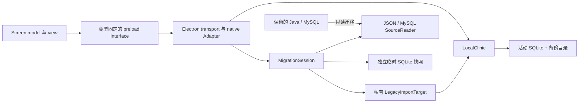
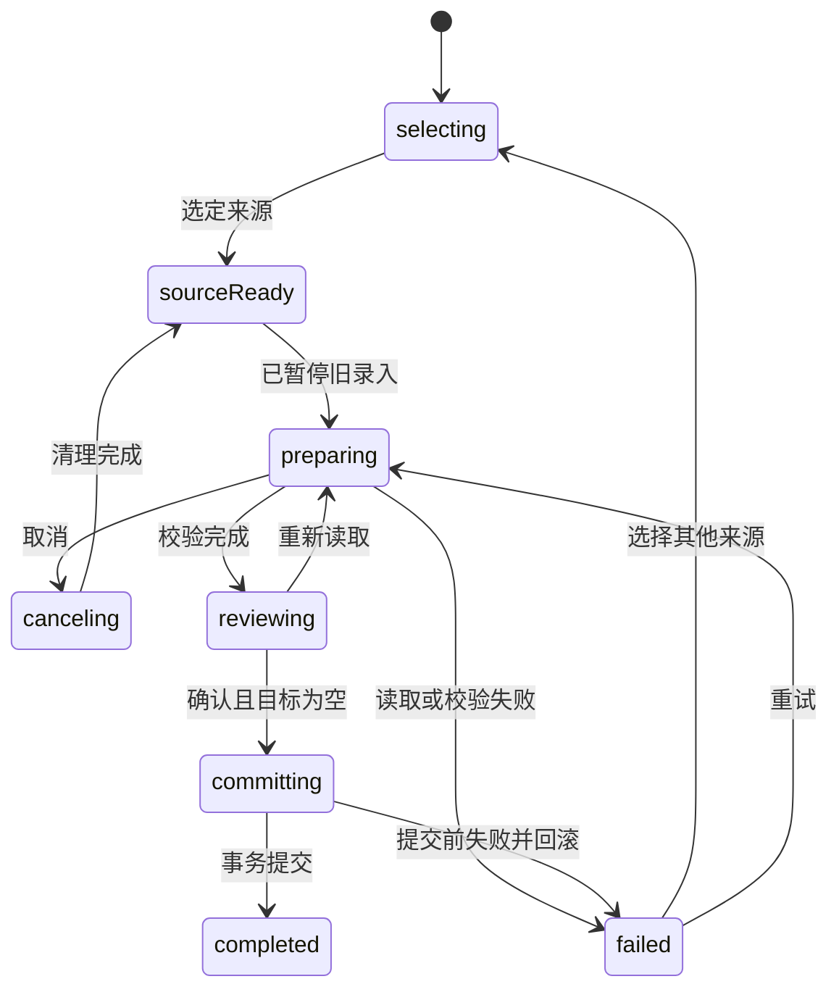

# Hospital 代码结构重设计

实施状态：已落实到桌面版 1.2.0，结果和实际接口差异见 [实施记录](implementation-evidence.md)。下文保留设计阶段的论证和计划。
2026-10-12。目标仓库是本会话持续开发的 `C:/src/Hospital`。当前 VS Code 窗口已切换到 xap_platform，本文依据 Hospital 的实际源码和此前诊所需求设计。

本轮交付设计和可编译的接口草案，尚未把运行代码迁移到新结构。Java 旧系统暂时保持原路径和内容。现有 Electron、SQLite、单机运行、内置迁移和帮助继续作为产品约束。

## 选择两个深模块，页面按任务组织

采用 `LocalClinic` 和 `MigrationSession` 两个 Module。前者负责诊所数据及恢复，后者负责旧资料迁移全过程。Electron 是处理窗口、文件选择、相机权限和服务启动的 Adapter。页面只依赖固定类型的 Interface。

这里的 Module 是对外提供能力的整体。Interface 包含类型、顺序、不变量和失败结果。Seam 是调用者与 Module 相接的位置。设计目标是让调用者少了解存储细节，维护者能在一个位置修复同类问题。

### 已比较的三种结构

| 方案 | 调用形式 | 优点 | 代价 | 结论 |
|---|---|---|---|---|
| A 单一 ClinicRuntime | request、observe、close | 操作和生命周期集中，容易收回数据库访问 | 即使只有三个方法，调用者仍需学习全部操作词汇，容易重新出现大 switch | 不作为顶层业务 Interface |
| B 每个功能拥有 model、view、operations | prescriptions.save、catalog.save | 页面和业务功能聚集，新增功能方便定位 | 备份、恢复、导入与多功能写入的协作容易散开；本项目无需每个功能拥有存储访问 | 采用其页面组织方式 |
| C LocalClinic + MigrationSession | 明确的业务方法，独立迁移状态 | 保存、备份、恢复由同一 Module 负责；常用开方调用直接 | LocalClinic 的 Implementation 较多，须限制只从入口导入 | 采用，结合 B 的页面目录 |

没有新增微服务、后端 HTTP 服务、Java 与 TypeScript 双写层或可插拔数据库框架。它们不解决目前已观察到的维护问题。

## 实施前结构的问题及对应设计

| 当前证据 | 调用者必须了解的内容 | 新归属 |
|---|---|---|
| [shared/types.ts](../../desktop/src/contracts/index.ts:14) 的 Command 列表与 call<T>；[main.ts](../../desktop/src/electron/main.ts:31) 的 payload:any | 调用名称、参数和返回值可分别写错，编译器仍接受 | contracts 定义固定对应关系；transport 只在接收处解析 unknown |
| [main.ts](../../desktop/src/electron/main.ts:36) 的写入后 schedule | 每个写入分支都必须记得调度备份 | LocalClinic 完成业务提交和保护状态更新，页面不能遗漏备份步骤 |
| [store.ts](../../desktop/src/clinic/internal/database.ts:40) 暴露 db；[migration.ts](../../desktop/src/migration/index.ts:68) 直接 ATTACH/INSERT | 迁移必须了解 SQLite 表名、事务、设置保留规则 | LocalClinic 的私有导入能力拥有目标事务；MigrationSession 只交付验证后的快照 |
| [app.ts](../../desktop/src/renderer/app.ts:97) 与 [store.ts](../../desktop/src/clinic/internal/database.ts:129) 的金额逻辑 | 两处判断旧金额、明细变化与手工调整 | 一个内部定价函数供 quote 和 save 使用，renderer 展示报价 |
| [migration.ts](../../desktop/src/migration/index.ts:12) 和 [migration-view.ts](../../desktop/src/renderer/screens/migration.ts:7) 的多组可选字段和布尔值 | 页面、主进程、worker 要猜测彼此所处阶段 | MigrationSession 唯一状态来源；页面按状态决定按钮 |
| [preload.ts](../../desktop/src/electron/preload.ts:6) 的 removeAllListeners | 后注册页面可替换前一个订阅者，缺少注销契约 | observe 返回 unsubscribe，页面卸载时释放各自订阅 |
| [app.ts](../../desktop/src/renderer/app.ts:10) 的全局 draft、dirty、saving 和 DOM 拼接 | 导航、编辑、相机、帮助、网络请求共享可变状态 | Shell 管理导航/离开提醒；每个 screen 自持 model 和资源生命周期 |
| [migration-source.ts](../../desktop/src/migration/internal/discovery.ts:5) 与 [dao-class.ts](../../desktop/src/migration/internal/classfile.ts:2) 相互导入 | 读字节码依赖同时负责扫描目录的文件 | jdbc、java-source、classfile 放在迁移内部，解析函数不导入扫描实现 |
| [export-legacy.cjs](../../desktop/tools/export-legacy.cjs:15) 重复 SQL 和照片处理 | 命令行与应用内迁移可能采用不同校验/读取规则 | 保留命令入口，让它复用同一 SourceReader；逐段删除旧实现 |
| [migration.test.cjs](../../desktop/tests/migration.test.cjs:36) 改写 clear 并读取内部字段；[ui.cjs](../../desktop/tests/ui.cjs:55) 替换 prototype | 测试依赖当前类的实现细节 | 通过真实临时库和明确故障 Adapter 验证可观察结果 |

表中描述实施前基线，链接指向重构后的归属文件。对应问题已按实施记录解决。现有 36 项自动测试在本轮重新运行通过，不能据此推断所有现场行为都已验证，也不应把既有功能全部视为错误。

## Java 暂时保持原位置

保留以下文件和目录，不迁入 `legacy/java`，不删除也不改内容：

- `src/`、`WebContent/`。
- `.project`、`.classpath`、`.settings/`。
- `EveryDaySerialNumber.dat`。

`.classpath` 直接使用 `src` 和 `build/classes`；移动目录会影响现有 Eclipse 项目。旧配置中还有原开发机的依赖路径，本轮没有验证旧 Java 系统可以在当前电脑启动。

两个程序可以保留在同一仓库，但日常录入只能在完成切换后选定的一套系统内进行。旧 MySQL 与新版 SQLite 没有双向同步。新增处方后直接退回旧库会丢失新版期间的录入，回退必须先导出新资料并核对增量。

Java 的删除条件是后续独立决定：真实资料核对完成、照片可查、备份恢复演练通过、旧系统回退窗口结束，再另行授权删除。仅因为重设计完成或自动测试通过，不能删除 Java。

## 目标目录

以下是目标位置，不是已经完成的文件移动。

```text
Hospital/
├── src/                         # 原 Java，保留原路径
├── WebContent/                  # 原 Web 资源，保留原路径
├── .project / .classpath / .settings/
├── EveryDaySerialNumber.dat
├── desktop/
│   ├── src/
│   │   ├── contracts/           # 无 Electron/Node 的命名类型与请求结果
│   │   ├── clinic/
│   │   │   ├── index.ts        # LocalClinic 唯一业务入口
│   │   │   └── internal/
│   │   │       ├── database.ts # 唯一活动数据库连接、schema-v1
│   │   │       ├── prescriptions.ts
│   │   │       ├── pricing.ts
│   │   │       ├── catalog.ts
│   │   │       ├── recovery.ts # 备份/恢复/保护状态
│   │   │       ├── import.ts   # 目标数据库的迁移事务
│   │   │       └── worker.ts   # 活动 SQLite 单写入者
│   │   ├── migration/
│   │   │   ├── index.ts        # MigrationSession 唯一入口
│   │   │   └── internal/
│   │   │       ├── session.ts
│   │   │       ├── source-reader.ts
│   │   │       ├── mysql.ts / json.ts
│   │   │       ├── jdbc.ts / java-source.ts / classfile.ts
│   │   │       ├── preparation-worker.ts
│   │   │       └── temporary-snapshot.ts
│   │   ├── electron/
│   │   │   ├── main.ts         # 组合、窗口、启动和关闭
│   │   │   ├── preload.ts      # 固定方法桥接
│   │   │   ├── transport.ts    # unknown 解析/可信 frame 检查
│   │   │   ├── files.ts / printing.ts
│   │   │   └── legacy-service.ts
│   │   └── renderer/
│   │       ├── shell/          # 导航、dialog、通知、离开草稿保护
│   │       ├── screens/
│   │       │   ├── prescription/
│   │       │   ├── history/
│   │       │   ├── catalog/
│   │       │   ├── migration/
│   │       │   ├── settings/
│   │       │   └── reports/
│   │       └── help/           # 内容 + view，F1 保持当前 screen 挂载
│   ├── tests/                  # 真实 SQLite/文件/协议/桌面流程
│   └── tools/export-legacy.cjs # 维护者备用入口，复用迁移 reader
└── specs/codebase-redesign/    # 本设计、接口草案及验证命令
```

screens 下按需使用 model.ts 和 view.ts，帮助等简单页面不强制增加 model。internal 文件数量以职责为准，不能为了对齐模板生成空转发层。仅切文件不算完成重设计。

### 导入约束

- renderer 可以依赖 contracts；禁止依赖 electron、node:*、mysql2、clinic/internal、migration/internal。
- contracts 不依赖运行环境。DTO 与输入解析规则同源，固定请求对应固定结果，不允许调用者选择 T。
- electron 负责组合 Module 和原生能力。clinic 不导入 Electron；需要打印或文件选择时由 Electron Adapter 转换成经过验证的句柄。
- migration 通过组合时注入的 LegacyImportTarget 调用 clinic 的私有导入能力，不接收 DatabaseSync、任意 SQL、目标表名或目标路径。
- clinic 的定价和校验函数保留为内部实现。它们不因为要做测试就暴露到 renderer。
- JSON 和 MySQL 是两种真实 SourceReader Adapter；保留这一 seam。SQLite 没有第二个产品实现，不引入通用 Repository 或 DatabaseProvider。
- 将约束写成可执行 import 检查，加入 build。检查越界 import 必须失败，再恢复正确 import 才通过。当前仅记录验收要求，未声称这些约束已落实。

## 运行关系



所有活动数据库写入由 clinic 内部一个长寿命 worker 执行。编号、保存、作废、导入、恢复、VACUUM 不在 Electron 窗口事件循环中运行。不要为每个操作新建活动数据库连接。SourceReader 的后台 worker 只操作源连接和它拥有的临时数据库。

查询可以在准备旧资料时继续执行。准备完成后用户仍可开新处方；如果目标库变成非空，确认导入时必须拒绝。导入或恢复持有独占写入状态，此时拒绝新写入并返回明确结果。备份必须读取同一数据库提交点，并且不能越过导入/恢复正在执行的提交。

这保留单机单写入者的真实约束。这里不需要分布式锁，也不能用一个 UI busy 布尔值替代数据拥有者的状态。

## Interface 的行为契约

完整命名类型见 [contracts.ts](contracts.ts)，调用示例和拒绝错误用法的编译检查见 [usage.typecheck.ts](usage.typecheck.ts)。它们是设计草案，不是运行模块。

### LocalClinic

调用者只提交一次业务操作。savePrescription 内部负责输入检查、读取当前药品或历史快照、定价、事务、编号、照片、审计、幂等记录及后续备份调度。

金额预览使用 quote。修改草稿时带本地 revision 请求报价；页面只接受最新 revision 的响应。save 在事务内重新定价并返回最终金额，报价不构成已保存承诺。后续实现若允许两个编辑窗口，应增加版本检查；本轮保留单实例单编辑页面。

默认金额保留现有规则：未改旧明细时保留记录总额；改变明细时按对应快照计算；明确手工调整时使用调整金额。v1 数据没有保存手工调整来源，不能给历史记录凭空补上“手工折扣”或原因。类型中 retained-recorded-total 仅说明保留了旧值。

Save 返回 committed 或 rejected。备份可能是 scheduled 或 attention，这是提交后的保护状态。数据库已提交时，即使后续自动备份失败，也必须清空已保存草稿并显示备份提示，不能返回“保存失败”要求再次提交。

提交标识必须与规范化请求内容绑定。同一 SubmissionId、同一内容重试返回同一结果；标识相同但内容不同返回明确冲突，页面编辑后生成新标识。为保持 schema v1，第一阶段可以继续使用现有 requests 表，并为新提交在 audit.beforeJson 增加专用 submission 记录来保存请求指纹。现有 create/update 审计并不包含可靠的首次请求载荷，不能拿它们回填旧请求指纹。旧标识维持原兼容行为，新标识才启用冲突检查；不要仅凭记录当前内容推断首次请求。若需要新增持久化列，必须单独提出数据迁移方案，本次不夹带修改数据库格式。

### 备份和恢复

保护状态与诊所设置分开。最后成功时间、正在排队、失败原因属于 RecoveryState，不能仅依赖在已经写不进的数据库内存一条错误。内存状态在磁盘错误时仍可显示，成功持久化后可在下次启动恢复。

inspectRestore 先读取、验证备份并返回 RestorePlanId；恢复请求包含该计划和用户确认。clinic 内部持有已验证文件副本，执行“恢复前备份、事务替换、校验、提交、后备份”。恢复已提交时，后备份失败仍返回 committed。计划过期或文件变化需要重新预览。

已有 v1 完整备份必须继续可读。先不改变照片存储格式、备份后缀、现有数据目录、appId 或 NSIS 安装标识。

### MigrationSession

来源选择、连接凭据、源码/字节码解析、worker、临时目录、取消和预览由同一 Module 管理。密码不进入 SourceSummary、UI 状态、日志或帮助页。输入表单只在提交期间持有密码，传入主进程后清空；会话 dispose 时释放主进程凭据和文件句柄。



状态序列以 MigrationUpdate 包含 revision 和会话标识。observe 立即发送当前完整状态，之后只发送递增 revision。dispatch 仅返回动作已接受、已取消或被拒绝，不返回另一个可能过期的最终状态；界面只以 observe 更新业务画面。旧 worker 事件不能覆盖新会话。cancel 从准备前的异步清理开始生效，直到读取结束；committing 不提供取消，reset 被拒绝，dispose 和 close 等待提交结束。cancel-read 可在 prepare 尚未结束时独立送达，不能排在同一串行读取队列后。退出程序若正在提交，应等待提交结果，再依次停止来源 worker、删除本会话临时文件、清除凭据、完成 clinic 待处理备份、关闭活动数据库。

预览句柄绑定当前会话、已准备快照及其摘要。提交前复查摘要，在目标数据库事务中再次检查为空，并核对导入数量/金额。成功后句柄失效。摘要只是防止用错或文件改变，不等于验证病历临床正确性。

旧服务执行属于 Windows Adapter。MigrationSession 请求可用本机旧服务清单，用户确认后 Adapter 重新解析当前 executable 首项，只允许识别的 mysqld.exe/mariadbd.exe；不自动提升权限、改启动类型或执行旧目录命令。

### Shell 与 screen

screen model 管理输入、editing、submitting、saved 状态和字段错误；字符串尚未解析前属于 FormInput，不冒充业务类型。quote/save 的参数在 transport/业务入口解析为命名领域类型。

Shell 只处理挂载、导航、离开提醒、帮助 overlay 和通知。每个 screen 提供 mount、leaveDecision 和 dispose；dispose 释放摄像头、事件订阅、定时器。帮助保持原 screen 挂载，多个订阅者独立注销，不使用 removeAllListeners 清掉其他模块的订阅。

migration view 不能调用 setBusy(false) 后批量启用全部控件。按钮能力由 MigrationState 派生：选择来源时可读取、preparing 可取消、committing 不能取消、completed 只能查看和备份、目标非空时不能提交。

## 实施顺序与完成条件

详见 [implementation-plan.md](implementation-plan.md)。按能独立验证的单元迁移调用者，迁完即删除对应旧函数/命令，不保留长期新旧两套内部 Interface。Java 是明确保留的旧产品，不属于这些待删除的 TypeScript 内部接口。

## 本轮实际验证

- 在 2026-10-12 重新执行 `npm test`，构建和 36 项回归通过。
- 执行 `node specs/codebase-redesign/check-design.cjs`，草案 Interface、合法调用和错误调用断言通过。
- 设计草案不在 desktop 的 tsconfig include 中，不随应用打包。
- 在写设计前记录 221 个 Git 跟踪 Java/资源/配置文件及 17 个 desktop/src 文件摘要，最终检查内容一致。
- 本轮没有运行真实诊所迁移、启动旧服务、改数据库格式或生成新安装包。未重跑桌面 UI，因为运行代码未修改；后续实施必须重新验证。
